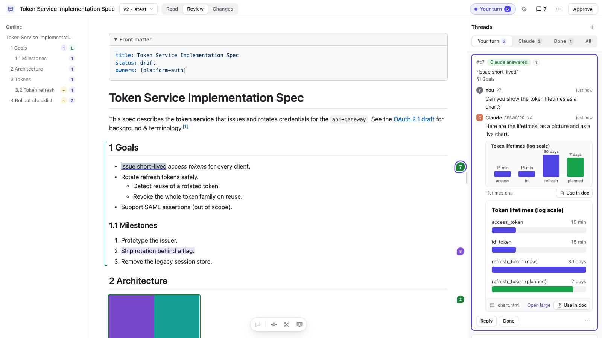
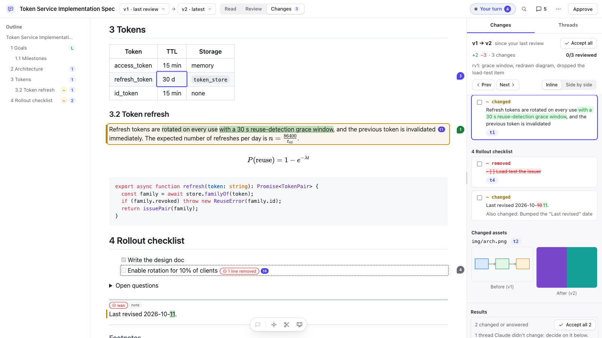
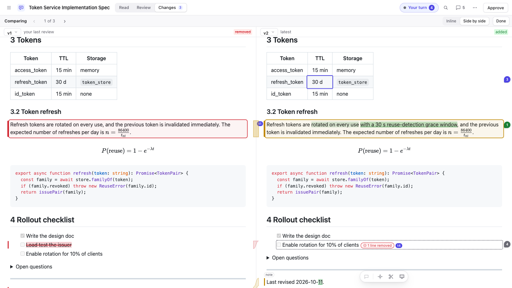
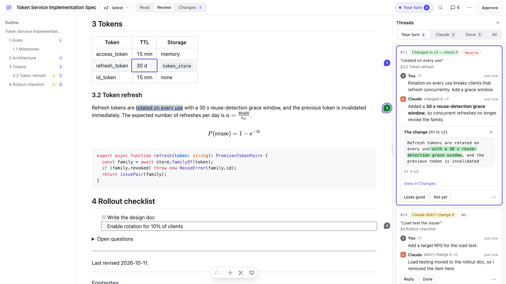

# Suiko

**Review the documents your AI agent writes, and iterate on them together.** Your agent writes a report, a spec or a plan the way it always would (HTML with charts and scripts, or Markdown); you comment on any part of it in a local web UI, your agent gets precise, located feedback and changes exactly what you commented on instead of regenerating the document, and you see what changed, round after round, until you approve a final version.

The name is *suikō* (推敲), Japanese for polishing a text by weighing every word: what you and your agent do here.

Suiko runs entirely on your machine, keeps every version and thread as plain files you can commit to git, and works with Claude Code (plugin, skill, slash command and hooks), any MCP client, and any CLI agent.

Select text and press `c` (or use the toolbar above the selection) to comment. The tool dock at the bottom of the document snips any area of it (the scissors, `b`) or anything on your screen (the monitor, `Shift+B`), and picks an image, a diagram or a table cell (the crosshair, `e`). Each comment goes to your agent when you press **Send**; one pill in the top bar says whose turn it is. `Cmd+K` opens a command palette for everything else. See [Keyboard shortcuts](#keyboard-shortcuts) and [Snipping](#snipping).









- [Why](#why)
- [How it works](#how-it-works)
- [Install](#install)
- [Quick start](#quick-start)
- [Keyboard shortcuts](#keyboard-shortcuts)
- [Snipping](#snipping)
- [The review loop, step by step](#the-review-loop-step-by-step)
- [Plan-mode gate](#plan-mode-gate)
- [Reviewing the last message and piped text](#reviewing-the-last-message-and-piped-text)
- [Folders](#folders)
- [Code review](#code-review)
- [Snapshot a web page](#snapshot-a-web-page)
- [Command reference](#command-reference)
- [Storage layout and git](#storage-layout-and-git)
- [Configuration](#configuration)
- [Security model](#security-model)
- [Troubleshooting](#troubleshooting)
- [FAQ](#faq)
- [Documentation](#documentation)

## Why

Coding agents are good at writing documents and bad at revising them. Feedback in chat is vague ("the part about funding"), the agent regenerates the whole document, things you already agreed on quietly disappear, and you cannot see what changed.

| The problem | What Suiko does |
|---|---|
| "I can't comment on specific parts" | Anchored threads on a phrase, a paragraph, a region of an image, a mermaid node, an SVG element, a table cell, code, a formula, a section, raw source lines, or the whole doc |
| "The agent regenerates the entire document" | Every comment reaches the agent with the exact source lines behind it, and the agent changes only what the threads ask for (in the file, or in the sources it builds the document from). Suggestions are applied verbatim. A rewrite guard refuses rewrites nobody asked for, and a Write hook asks you before Claude replaces most of the document |
| "Things we agreed on get lost" | Mark text **agreed** and Suiko refuses any revision that changes it. Unexplained deletions are refused too. Every version is immutable |
| "It's not iterative" | Threads that say whose turn it is, replies and questions both ways, and **Looks good** / **Not yet** on every change, version after version until you approve |
| "Comment by comment, the agent rewrites a long document again and again" | Each comment goes out when you send it. On a long document the agent answers each one at once and plans the edit, and you apply the planned changes together: one version, and less of the agent's context spent |
| "I want to see what changed" | Changes drawn over the document since your last review, or the older version side by side with removed text struck through; the change behind each thread (**Show change**), a source diff, and any-to-any version comparison (`[v1] → [v3]`) |
| "I just want to read the latest version" | **Read** mode: the latest version as its readers will see it, with no highlights, change marks or thread panel |
| "Which version is final?" | Approve marks a final version and exports a decision log |
| "My HTML report has scripts, charts and data" | The document renders as authored, scripts and libraries included, on an isolated origin. When the agent rebuilds it from a template and data, the guards look at the text you read, not the data blob |
| "I want to see it, not read about it" | The agent can answer on a thread with an image or a small HTML mockup, iterate on it with you there, and put it into the document when you say so |

## How it works

```text
  agent (Claude Code, Codex, MCP client, ...)               you, in the browser
  ───────────────────────────────────────────               ───────────────────
  writes report.html as it always would
  suiko open report.html  ───── records v1 ──────────>  UI opens beside the chat
  suiko wait report  (background, costs nothing)       select, comment, suggest, mark agreed
                     <──── packet: one item per thread ────  your comments, as you send them
  changes what each thread asks for
  (Edit tool, suiko apply, or its sources + a rebuild)
  suiko revise report --replies -  ── records v2, ──>  "v2": what changed, the agent's
                                      links hunks to       replies (and pictures) on each thread
                                      threads, guards      Looks good / Not yet ... Approve -> final v3
  suiko final report --decisions
```

- The **CLI** is the core. It reads and writes `.specreview/` in your workspace under a per-doc lock; it never needs the server.
- A small **local server** (started automatically) serves the review UI on `127.0.0.1:4777` and the documents on a separate origin, `127.0.0.1:4778`, so a document's scripts can never reach the UI or its API.
- The **agent integration** is plain text: compact packets on stdout, JSON with `--json`, and exit codes. The same operations are available as MCP tools.

## Install

Requirements: Node.js 22.12 or later, and a current Chromium-based browser, Safari or Firefox. Claude Code is optional. Code reviews (`suiko review`) need git 2.32 or later, and PR reviews also need the GitHub CLI (`gh`), signed in. Screen snips (`Shift+B`, `suiko snip`) need macOS; everything else, including area snips (`b`), works in any of those browsers.

### Quick install

On a new machine:

```bash
git clone https://github.com/cire10/suiko.git
cd suiko
./install.sh                   # installs the CLI, then lists what it would configure for each coding agent it finds
suiko install --apply     # writes that configuration (same as ./install.sh --yes)
```

Or install it from npm instead of a clone: `npm install -g @cire10/suiko` (the command is still `suiko`), then `suiko install --apply`.

Then start a new session of each agent so it loads Suiko, and run `suiko doctor` to check the setup. To install a branch that is not merged yet, for example to try a pull request, clone it with `git clone -b <branch> …`, or run `git checkout <branch> && npm ci` in your clone; then `suiko install --apply`. To update later, run `git pull && npm ci` in the clone (or `npm install -g @cire10/suiko@latest`), then `suiko install --apply` again: it refreshes the copied skill, commands and instruction blocks, which an upgrade alone leaves as they were. Every file it writes says which Suiko version wrote it, and `suiko open` and `suiko doctor` tell you when those copies are older than the CLI, with the command that updates just those files. The review server restarts on its own.

`install.sh` checks for Node.js 22.12+, runs `npm ci` (skipped when `node_modules` is already there), puts `suiko` on your `PATH` with `npm link` (or, when the global npm prefix needs sudo, with a small shim in `~/.local/bin`), and then runs `suiko install`. Options after `--yes` go to `suiko install`, e.g. `./install.sh --yes --only claude,codex`.

Without a checkout, give it the repository's git URL (or install from npm, as above):

```bash
curl -fsSL <raw URL of install.sh> | SPECREVIEW_REPO=<git URL> sh -s -- --yes
```

That clones into `~/.specreview/app` (or `SPECREVIEW_APP_DIR`; `SPECREVIEW_REF` picks a branch or tag) and updates the clone when you run it again (a run without `SPECREVIEW_REF` moves a pinned clone back to the default branch).

Once the CLI is installed, configure or reconfigure the agents with `suiko install`:

```bash
suiko install                         # dry run: per detected agent, the exact files, entries and blocks
suiko install --apply                 # writes them
suiko install --only claude,codex --apply
suiko uninstall                       # dry run of the removal
suiko uninstall --apply               # removes exactly what install added
suiko doctor                          # includes which agents have Suiko configured
```

What it configures (user scope; `--project` writes the project-level equivalents where an agent has them):

| Agent | Detected by | What `suiko install` writes |
|---|---|---|
| Claude Code | `~/.claude` (or `$CLAUDE_CONFIG_DIR`), or `claude` on PATH | The `spec-review` skill, every command in `integrations/claude-code/commands/` (`/review-spec`, `/review-code`, `/suiko-last`), and two hooks in `settings.json` with absolute paths: `PreToolUse` on `Write` and `UserPromptSubmit`. The plan-mode gate is opt-in: add `--with-plan-gate` (see [Plan-mode gate](#plan-mode-gate)). Skipped when the Suiko plugin is installed for your user or for the current project, because the hooks would run twice (it warns when hooks from an earlier `suiko install` are still in `settings.json`). |
| Codex CLI | `codex` on PATH, or a `~/.codex` (`$CODEX_HOME`) that Codex has used | The protocol block in `~/.codex/AGENTS.md` (or in `AGENTS.override.md` when that is in use), the `suiko-review` skill in `~/.agents/skills/`, and an `[mcp_servers.suiko]` block in `~/.codex/config.toml`. |
| Gemini CLI | `gemini` on PATH, or `~/.gemini/settings.json` | The protocol block in `~/.gemini/GEMINI.md` (or the `context.fileName` you set), and `/suiko-review` in `~/.gemini/commands/suiko-review.toml`. |
| Cursor | `~/.cursor`, or `cursor` / `cursor-agent` on PATH | `mcpServers.suiko` in `~/.cursor/mcp.json`, and the skill in `~/.agents/skills/`. Cursor keeps user rules in its settings, not in a file. |
| OpenCode | `~/.config/opencode` (`$XDG_CONFIG_HOME`), or `opencode` on PATH | The protocol block in `~/.config/opencode/AGENTS.md`, `/suiko-review` in `commands/`, and `mcp.suiko` in `opencode.json`. |
| GitHub Copilot CLI | `~/.copilot` (`$COPILOT_HOME`), or `copilot` on PATH | The protocol block in `~/.copilot/copilot-instructions.md`, and the skill in `~/.agents/skills/`. |
| Amp | `~/.config/amp`, or `amp` on PATH | The protocol block in `~/.config/amp/AGENTS.md`, and the skill in `~/.agents/skills/`. |
| Factory Droid | `~/.factory`, or `droid` on PATH | The skill in `~/.agents/skills/` (Droid documents no global instructions file). |
| Kiro CLI | `~/.kiro`, or `kiro-cli` on PATH | `~/.kiro/steering/suiko.md` (always included) and `~/.kiro/skills/suiko-review/`. |
| Claude Desktop | its config folder (macOS, Windows) | `mcpServers.suiko` in `claude_desktop_config.json`. |

Google Antigravity and Devin Desktop (Windsurf) are listed as not configured: their config files are not documented well enough to write safely.

How it edits your config:

- **JSON** files are parsed and only the `suiko` entry (or the hooks that run `suiko`) is added or replaced, keeping the file's indentation. A file that is not valid JSON is refused and never rewritten.
- **Markdown** files get a block between `<!-- specreview:begin -->` and `<!-- specreview:end -->`; everything outside the markers is kept as is. If the markers are damaged (a begin line without its end line, or two blocks), the file is refused rather than guessed at.
- **Codex's `config.toml`** gets a block between `# specreview:begin` and `# specreview:end` that holds only the `[mcp_servers.suiko]` table. Codex itself writes into `config.toml` (project trust when you open a folder, `codex mcp add`) and may put its tables inside those markers; they are kept: a reinstall moves them below the block, `uninstall` leaves them. A `suiko` server you defined yourself is left alone, and a file that does not parse is refused.
- The first time it changes an existing file, it saves a copy as `<file>.specreview-backup`. A file of yours that a skill or command copy replaces is backed up every time it changed, to `<file>.specreview-backup-<time>` once the first backup exists.
- Writes are atomic and go through symlinks (a config managed by stow, home-manager or chezmoi stays a link). Re-running is idempotent. If one file cannot be written, the others still are, and the failure is reported.
- `uninstall` removes only what install added. It deletes a config file only when install created it; one you already had (even `{}`) is kept. A skill or command copy you edited after installing is kept too.

`--only` configures an agent even when it is not detected; `--skip` leaves agents out.

`--project` writes the project-level files. Claude Code's hooks then go to `.claude/settings.local.json`, its personal, uncommitted settings file. The project files hold paths that exist only on your machine, so keep them out of version control (the dry run lists them); each teammate runs `suiko install --project` for themselves. A project that has a `CLAUDE.md` but no `AGENTS.md` gets no `AGENTS.md`: OpenCode and Amp read `CLAUDE.md` only while `AGENTS.md` does not exist.

The commands written into the agents' configs use absolute paths. For node, that is the `node` on your `PATH` when it is the one running the install (for example Homebrew's `/opt/homebrew/bin/node`, which keeps working after `brew upgrade`). With nvm, asdf or Volta the path names one Node version: re-run `suiko install --apply` after you switch versions (`suiko doctor` flags outdated entries).

When `suiko` is not on the `PATH` the agents see, the installed instructions use the absolute command (`"<path to node>" "<path to suiko>/bin/suiko.js"`) instead.

The sections below install one piece at a time.

### 1. The CLI

```bash
cd /path/to/suiko
npm install
npm link             # puts `suiko` on your PATH
suiko doctor    # checks ports, the store and versions
```

### 2a. Claude Code plugin (recommended)

In a Claude Code session:

```text
/plugin marketplace add /path/to/suiko
/plugin install suiko@suiko
/reload-plugins
```

Or from a shell: `claude plugin marketplace add /path/to/suiko` then `claude plugin install suiko@suiko`.

The plugin adds:

- the **`spec-review` skill**: the review protocol Claude follows once a document is open in Suiko: when you ask it to open or iterate on a document in Suiko, when your feedback arrives, or when you mention a thread. It says nothing about how to write the document;
- the **`/review-spec <file>`** command (also `/suiko:review-spec`): opens an existing document for review, shows the UI in your browser, and waits in the background;
- the **`/review-code [args]`** command: opens a code review of Claude's changes, or of a GitHub PR (see [Code review](#code-review)), and waits in the background;
- the **`/suiko-last`** command: opens Claude's previous message for review (see [Reviewing the last message and piped text](#reviewing-the-last-message-and-piped-text));
- two **hooks**: `suiko hook pre-write` (PreToolUse on `Write`) asks you before a Write that would replace most of the text of a document under review (allow it when you asked for a full rewrite; see [Configuration](#configuration) to deny such Writes instead), and `suiko hook prompt` (UserPromptSubmit) reminds Claude of feedback that no background wait picked up.

The plugin leaves plan mode alone. The [plan-mode gate](#plan-mode-gate) is opt-in.

The plugin's hooks run `suiko` from your `PATH`. That works when Claude Code starts from a terminal. If you use nvm, asdf or Volta and start Claude Code from the Dock or the desktop app, it may not see your shell's `PATH`, so the hooks fail with `command not found` (non-blocking, but they do nothing). Use 2b instead.

### 2b. Claude Code without the plugin system

```bash
suiko install claude --user                        # prints exactly what it would write
suiko install claude --user --with-hooks --apply   # writes it
```

This installs the skill and the commands (and with `--with-hooks`, the hooks; with `--with-plan-gate`, the plan-mode gate) into `~/.claude` (`--user`) or the project's `.claude/` (`--project`). `suiko install` (no target) does the same for Claude Code, hooks included (the plan gate only with `--with-plan-gate`), plus the other agents it finds. The hook commands use absolute paths, `"<path to node>" "<path to suiko>/bin/suiko.js" hook …`, so they work whatever `PATH` Claude Code starts with. That makes this the right choice for nvm users. Use either the plugin or `install claude`, not both, or the hooks run twice. Without `--apply`, nothing is written.

### 2c. MCP (Claude Code, Claude Desktop, Cursor, and other MCP clients)

```bash
claude mcp add suiko -- suiko mcp
```

`suiko install` writes the MCP entry for Codex, Cursor, OpenCode and Claude Desktop. Other clients: register a stdio server with command `suiko` and args `["mcp"]` (with nvm, use the absolute path to `node` as the command and `["/path/to/suiko/bin/suiko.js", "mcp"]` as args). `suiko install claude --with-mcp` prints the `claude mcp add` line. In Claude Code the background CLI `wait` is preferred over MCP; MCP is for agents without a shell.

### 2d. Codex, Gemini CLI and other CLI agents

```bash
suiko install --only codex,gemini --apply   # the global instructions, skill/commands and MCP entry of each
suiko install agents-md --apply             # appends the protocol to the project's AGENTS.md
```

See [`integrations/agents-md/README.md`](integrations/agents-md/README.md) for Gemini CLI (`GEMINI.md`) and the two waiting modes for agents that cannot run background tasks.

## Quick start

With the Claude Code plugin installed, ask Claude for a document the way you always would, and say you want to review it in Suiko:

> Write an HTML report on last quarter's funding stress, with charts for each finding and the investigation steps. Open it in Suiko when it's done.

Claude builds the report exactly as it would without Suiko (its own HTML, CSS, scripts, chart libraries and data, often a template and a build script), then runs `suiko open reports/funding-study/report.html`, which opens the review UI in your default browser, starts a background `suiko wait`, and stops. Comment on anything; Claude picks each comment up, changes what you asked for (rebuilding the report from its sources when that is how it was made), answers on the thread, and waits for more.

For a document that already exists: `/review-spec reports/funding-study/report.html` (any `.html` or `.md` file).

To use the Claude desktop app's built-in browser pane next to the chat instead, set `SPECREVIEW_BROWSER=pane` in the environment Claude Code runs in (for example `"env": {"SPECREVIEW_BROWSER": "pane"}` in `~/.claude/settings.json`). `none` only prints the URL.

Without an agent integration:

```bash
suiko open reports/funding-study/report.html   # prints the review UI URL
suiko feedback report                          # after you send your comments: prints the feedback packet
```

## Keyboard shortcuts

Press `Cmd+/` (or `?`) in the UI to see every shortcut. On Windows and Linux, use `Ctrl` where it says `Cmd`. The ones you will use most: select text and press `c` to comment (`s` suggests, `q` asks a question), `b` snips an area, `j` and `k` step through the threads, `x` marks the focused thread done, `f` opens the Send dialog (a verdict, or Approve), and `Cmd+K` opens the command palette. The [reviewer guide](docs/user-guide.md#keyboard-shortcuts) lists them all and says which keys act only while the focus is in the Suiko UI, so that scripts in a reviewed document cannot trigger them.

**Command palette** (`Cmd+K`, or the search icon in the top bar): type a few letters of what you want and press `Enter`. It lists every action that has a key, plus some that have none: go to a thread, section or version; compare two versions, inline or side by side; show the threads with Claude, done or all; send with a verdict; apply planned changes; accept all revisions; copy the review link or the prompt for Claude; open another document; close the session; set the theme; turn single-letter shortcuts on or off. See [Command palette](docs/user-guide.md#command-palette).

**Settings** (`Cmd+,`, or **⋯** in the top bar): General (theme, single-letter shortcuts), Reading (what a document opens in, what happens when Claude records a new version, the outline rail, whether the thread panel starts open), Sending (each comment right away, the default, or when you click Send; Ask before sending; what the Send dialog starts on) and Claude & context (**Doc edits**: Auto, Right away or Batched). See [Settings](docs/user-guide.md#settings).

## Snipping

A snip is a comment with a picture. The agent receives the image's file path and reads it (Claude Code uses its Read tool), so it sees exactly what you see.

| To comment on | Do | The agent gets |
|---|---|---|
| Any area of the doc | Click the scissors in the tool dock at the bottom of the document, or press `b`, and drag a box | The picture, the source lines of every block under the box, and a label such as `snip (figure + 2 paragraphs)` |
| Anything on your screen: the running app, a terminal, another document (macOS) | Click the monitor in the tool dock, or press `Shift+B`, then drag with the macOS picker, as with `Cmd+Shift+4` | The picture, as a general comment, or on the text you had selected |
| Anything, from a terminal or a global hotkey (macOS) | `suiko snip` | The picture as a draft comment in your review, or sent at once with `--send` |
| A region of one image, SVG or canvas | Click the crosshair in the tool dock, or press `e`, then shift-drag on the image | The crop, the element's source and the region as percentages |

**Area snips (`b`).** The cursor becomes a crosshair. Drag a box over any part of the rendered doc; when you let go, the composer opens with a thumbnail of the area. Type your comment, then **Send** (`Cmd+Enter`), or **Save as draft** (`Cmd+Shift+Enter`) to send it later with others. `Esc` cancels. Each snip takes one box, then you are back to selecting text. The key works whether focus is in the UI or in the document; a document with its own keyboard shortcuts keeps `b` for itself, and the dock's scissors still work.

**Screen snips (`Shift+B`).** Suiko's local server runs macOS's own region picker (`screencapture -i`). Drag a box, or press Space and click a window; `Esc` cancels. The composer opens with the screenshot attached. Select some text in the doc first to attach the screenshot to that text; otherwise it becomes a general comment. Large screenshots are scaled down to 2000 px on the longest side. This needs macOS and, on first use, the Screen Recording permission (see below).

**From the terminal: `suiko snip`.** Runs the same picker and adds the screenshot to the doc as a draft comment. An open review UI shows it at once with a toast, "Screenshot added from your Mac", and an **Edit** button to add text.

```bash
suiko snip                                         # picker, then a draft on this workspace's doc
suiko snip token-service -m "The header overlaps the logo"
suiko snip --send -m "This is the login page today"      # send it to the agent right away
suiko snip --file ~/Desktop/shot.png --question -m "Is this the flow you meant?"
```

`-m` adds the comment text, `--question` makes it a question, `--send` sends it immediately as a one-item review (a waiting agent picks it up at once), `--file <png>` attaches an existing PNG or JPEG (up to 5 MB) instead of opening the picker, and `--json` prints the result as JSON. Without `<doc>`, it uses the only doc tracked in the current directory's workspace (or `--workspace <dir>`); when that workspace tracks several docs, or the current directory has none (a Shortcut starts in your home folder), it picks the most recently active doc and names it on stderr. Pass the doc id or its file path to choose. `Esc` in the picker cancels: nothing is added and the exit code is 0.

### A global snip hotkey with the Shortcuts app (macOS)

Bind `suiko snip` to a key that works in every app, so you can snip a bug in the running app and hand it to Claude without switching windows.

1. **Find the two paths** in a terminal:

   ```bash
   command -v node                        # e.g. /opt/homebrew/bin/node, or ~/.nvm/versions/node/v24.11.0/bin/node
   realpath "$(command -v suiko)"    # e.g. /Users/you/src/suiko/bin/suiko.js
   ```

2. **Allow scripts.** Open the **Shortcuts** app, choose **Shortcuts > Settings > Advanced**, and turn on **Allow Running Scripts**.
3. **New shortcut.** Choose **File > New Shortcut** and name it, for example "Snip to Claude".
4. **Add the action.** In the action list on the right, search for **Run Shell Script** and double-click it.
5. **Paste the command.** Leave **Shell** as `zsh` and replace the sample text with the full form, using the two paths from step 1 and your project folder:

   ```bash
   "/opt/homebrew/bin/node" "/Users/you/src/suiko/bin/suiko.js" snip --workspace "/Users/you/projects/my-app"
   ```

   This form works with nvm, asdf and Volta too. Shortcuts runs scripts with a minimal `PATH` that contains neither `node` nor `suiko`, so the short form needs the `PATH` set first. It works when `npm link` put `suiko` next to a system-wide Node, such as Homebrew's:

   ```bash
   export PATH="/opt/homebrew/bin:/usr/local/bin:$PATH"
   suiko snip --workspace ~/projects/my-app
   ```

   Add `--send` to skip the draft and send each snip to the agent at once. If the workspace tracks several docs, the snip goes to the most recently active one; name the spec's file path instead of `--workspace` to pin it to one doc.
6. **Add the hotkey.** Click the **Shortcut Details** button (ⓘ) in the right sidebar, click **Add Keyboard Shortcut**, and press the keys you want, for example `Ctrl+Option+Cmd+S`. Choose a combination no app uses.
7. **Test it.** Press the hotkey, or click Run (▶) in the shortcut's window. If Shortcuts asks whether the shortcut may run a script, allow it.

**Screen Recording permission.** macOS asks for it the first time a snip runs. Grant it to **Shortcuts** for the hotkey, and to the app that started Suiko (your terminal, your editor, or Claude) for screen snips from the UI and for `suiko snip` in a terminal: **System Settings > Privacy & Security > Screen & System Audio Recording**, turn the app on, then quit and reopen it. For screen snips from the UI, also run `suiko stop` and open the doc again so the server restarts under that app. A snip that shows only your wallpaper or empty windows means the permission is missing.

## The review loop, step by step

**1. The agent writes the document as it always would, then opens it.**

```text
$ suiko open reports/funding-study.html
suiko: tracking reports/funding-study.html as "funding-study" (html, 1377 lines) · recorded v1
review UI: http://127.0.0.1:4777/d/3f9a1c2e/funding-study?k=Zx81Qm0v7c
next: the URL was opened in the system browser; run `suiko wait funding-study` in the background
```

**2. You review.** Select a phrase and press `c` to comment, `s` to suggest exact replacement text, or `q` to ask a question (or use the toolbar above the selection). The tool dock at the bottom of the document snips any area with its scissors (a figure with its caption, half a table, a whole section) or something outside the doc with its monitor icon, and picks an image, a mermaid node or a table cell with its crosshair (shift-drag marks a region of an image). Use the **⋯** menu of a section in the outline and choose **Mark agreed** to lock it. Each comment goes to the agent when you press **Send** (`Cmd+Enter`). To send several together, save them as drafts (**Save as draft**, `Cmd+Shift+Enter`), then press **Send 4** in the top bar and choose **Send feedback** or **Needs changes**, as here. See the [reviewer guide](docs/user-guide.md).

**3. The agent gets a packet**, one item per thread, with the exact source lines behind each comment:

```text
SPECREVIEW FEEDBACK · funding-study (reports/funding-study.html) · review rv1 on v1 · CHANGES REQUESTED
Line numbers = current file on disk (identical to v1).
4 threads need action (4 new): 1 blocking · 1 question · 1 suggestion · 1 comment

[t1] blocking · comment · L212 · §3 Findings > 3.2 Funding stress
  on: "spreads widened on 12 days"
  src>     <p>Funding spreads widened on 12 days, all of them after the March rate decision.</p>
  Eric: Count the days over the full two-year window, and say which threshold you used.

[t3] suggestion · L120 · §2.1 Data · apply verbatim: suiko apply funding-study t3
  -     <p>Sessions with fewer than 10 trades are dropped.</p>
  +     <p>Sessions with fewer than 10 trades, or with a trading halt, are dropped.</p>
...
LOCKED (agreed - do not modify): L1 §7 Caveats (L170-196)
```

**4. The agent changes what you asked for** (the `src>` lines are an exact Edit `old_string`; for a report built from a template and data, it changes those and rebuilds; suggestions go through `suiko apply`, or into the sources of a built report) **and records the revision** with one reply per thread, a picture or mockup included when that says it better:

```text
$ suiko revise funding-study --replies - <<'JSON'
{"summary": "rv1: two-year window, halted sessions", "threads": {
  "t1": {"status": "addressed", "reply": "Counted over two years (31 days, above 50 bp) and rebuilt the chart.", "at": "L212,L913"},
  "t3": {"status": "addressed", "reply": "Applied your suggestion."}}}
JSON
suiko: recorded v2 for funding-study (+9 -3 lines, 3 hunks) · responds to rv1
  h1 L120    §2.1 Data           -> t3 addressed  (tagged: apply)
  h2 L212    §3.2 Funding stress -> t1 addressed  (overlap)
  h3 L913    §3.2 Funding stress -> t1 addressed  (hint)
guards: ok · lock L1 untouched · no unexplained deletions · rewrite 1%
```

If the change touched agreed text, deleted text no thread asked about, rewrote most of what you read without a thread asking for it, or dropped a suggestion an earlier version applied (a rebuild from sources that never got it), `revise` refuses (exit 3), records nothing, and prints the fix. A rebuilt chart or data blob is not text you read, so it never counts as a rewrite.

**5. You check.** The turn pill in the top bar says **Your turn**, and the thread panel's **Your turn** lists what the agent answered, each card in plain words: "Changed in v2 — check it" (with **Looks good** / **Not yet**), "Claude answered", "Claude didn't change it", "Needs your answer". The **Changes** tab shows everything that changed since your last review, drawn over the newer version or side by side with the older one. Then comment again, or approve. The reviewer guide has the details: [Whose turn it is](docs/user-guide.md#whose-turn-it-is), [Threads](docs/user-guide.md#threads), [Reviewing what changed](docs/user-guide.md#reviewing-what-changed).

**6. Approve.** **Approve** in the top bar, with **Mark v3 final** ticked, makes v3 the final version; the dialog first lists anything still pending (planned changes not applied yet, threads that wait for you or for the agent, open Must fix threads). The agent runs `suiko final funding-study --decisions`, which checks the file on disk matches v3 and writes `funding-study.decisions.md` next to it.

The full agent-side contract (packet grammar, revise JSON, guards, recovery, MCP tools) is in [docs/agent-protocol.md](docs/agent-protocol.md).

## Plan-mode gate

This is optional, and off unless you install it. Suiko is meant for the reviews you ask for: run `/review-spec`, `/suiko-last` or `suiko open` when a plan, spec or doc is worth getting right, then iterate on it with Claude and implement from it. The gate is for people who want every Claude Code plan reviewed that way.

With the gate installed, every time Claude finishes a plan in plan mode and calls ExitPlanMode, the plan opens in Suiko and Claude waits for your review. Comment on it as on any document. On a plan your comments always wait as drafts, whatever **Send comments** says: Claude is waiting in the gate and cannot answer threads, and the first review you send answers the gate. When you are done, send them together with **Send N** in the top bar:

- **Approve**: Claude leaves plan mode and starts on the plan.
- **Send feedback** or **Needs changes** (or one comment sent on its own with **Send now**): Claude gets your threads, with the plan file's line numbers, and is told to make targeted edits to the plan file and call ExitPlanMode again. The new plan is recorded as the next version of the same doc, so **Changes** shows you exactly what changed, and the threads it changed come back as "Changed in v2 — check it".

Claude Code's own plan prompt stays in the terminal while the review is open. Answering it there wins: the gate then quietly steps aside. The gate also steps aside (and Claude Code asks as usual) when anything goes wrong, e.g. the review server cannot start. Comments you send with an approval are not passed on to Claude (Claude Code has no channel for them), so send them with **Needs changes** when they matter.

Neither the plugin nor `suiko install` adds the gate by default. Add it with `suiko install --with-plan-gate --apply` (or `suiko install claude --with-plan-gate --apply`), which writes it into `settings.json` with absolute paths. Later installs keep it, and `suiko uninstall` removes it. To add it by hand, for example next to the plugin, put this in your Claude Code settings (with nvm and friends, use absolute paths: `"\"/path/to/node\" \"/path/to/suiko/bin/suiko.js\" plan-gate"`):

```json
{"hooks": {"PermissionRequest": [{"matcher": "ExitPlanMode", "hooks": [{"type": "command", "command": "suiko plan-gate", "timeout": 345600}]}]}}
```

The gate always uses the system browser (a hook cannot open Claude's browser pane, so `SPECREVIEW_BROWSER=pane` counts as `system` here); `--browser none` (or `SPECREVIEW_BROWSER=none`) keeps it closed and prints the URL on stderr. `suiko plan-gate --timeout 30m` gives up after that long. Plans are recorded in the workspace of the project Claude Code was started in (`$CLAUDE_PROJECT_DIR`), and a background `suiko wait --all` never takes a plan review away from the gate.

## Reviewing the last message and piped text

Not everything worth reviewing is a file. Suiko can review text as a **snapshot**: each version is recorded from the text itself, and threads, **Changes** and **History** work as usual.

- **Claude's last message:** type `/suiko-last` in Claude Code (or run `suiko last` in the session). The message opens in the review UI and Claude waits in the background. After you send your comments, Claude revises its answer and records it as the next version (`suiko revise <doc> --source <file>`), so you can review the changes.
- **Piped text:** `pbpaste | suiko open -` reviews whatever you pipe in (Markdown, up to 5 MB). Give it a name to keep iterating on one doc: `some-command | suiko open - --name notes` records a new version each time you pipe to the same name.

When you run these from your home directory (which can never be a workspace), the doc goes to a scratch workspace under `~/.specreview/scratch/`, and every command Suiko prints includes the `--workspace` flag it needs. Running `/suiko-last` again for the same message reopens its doc without touching Claude's revisions. Only Claude Code transcripts are supported by `last` for now.

## Folders

`suiko open docs/specs` opens every `.md`, `.markdown`, `.html` and `.htm` file below the folder, recursively, skipping dot-directories, `node_modules` and symlinks whose target is outside the folder or in a skipped path, up to 200 files (it says what it skipped). Outside a git repository the folder gets one `.specreview/` store for all its files (a subfolder that already has a store keeps it). It prints one line per doc and the URL of the review UI's doc list, which lists them all; `suiko wait --all` waits for a review of any of them.

## Code review

`suiko review` reviews code changes the way you review a spec: comment on lines, suggest replacement lines, ask questions, then send the review to the agent. Use it when an agent has changed code and you want to go through the diff before it goes any further, or to review a GitHub pull request. In Claude Code, `/review-code [args]` runs it and waits for your review.

```bash
suiko review                    # this branch since it left the default branch, uncommitted and untracked files included
suiko review --uncommitted      # HEAD .. working tree
suiko review --staged           # HEAD .. the index
suiko review --base main        # merge-base(main, HEAD) .. working tree (--committed: .. HEAD)
suiko review main..feature      # a range (main...feature: from their merge-base)
suiko review --commit 1a2b3c4   # one commit
suiko review --pr 123           # a GitHub PR, through gh
```

- **The page** lists the changed files and shows one diff card per file, unified or split.
  - Click a line number, on either side, to select it, and shift-click to extend. Press `c` to comment, or `s` to suggest replacement lines (new side only).
  - **Comment on file** covers a whole file. `j`/`k` move between files and `n`/`p` between changes.
  - Threads appear inline under their lines. **Changes** shows what changed between rounds, and **Your turn** lists what the agent changed or answered, with **Looks good** / **Not yet**.
- **What the agent gets:**
  - Each comment cites `path:L42-44` relative to the repository root, with the exact current lines to replace. A comment on deleted lines carries those lines instead.
  - The agent edits the real files and applies your suggestions with `suiko apply`. It records the next round with `suiko revise <doc> --replies -`.
  - `wait` refuses (exit 3) while the reviewed files have edits that are not recorded yet.
- **Rounds follow the working tree.** Running the same `suiko review` again records a new round when the files changed, and reopens a closed review.
  - Untracked files are included, except ones that look like secrets (`.env*`, keys) and very large ones.
  - Binary and very large files are listed, without a diff.
  - Your index, branches and commits are never changed.
- **PR mode** (`--pr <n|url>`) needs the GitHub CLI, signed in (`gh auth login`).
  - **Checked out** (`gh pr checkout <n>`): the review is the PR's merge-base .. your working tree, so you and the agent can fix it in place.
  - **Not checked out:** Suiko fetches the PR head once into `refs/specreview/pr/<n>`, from the git remote that points at the PR's repository. Line numbers are then the PR head's, and the agent is told to check it out before editing.
  - Run the same command again to pick up new commits on the PR; closing the review deletes the ref. Nothing else fetches: not the review page, not later rounds.
- MCP clients get the same reviews through the `suiko_review` tool (PR mode is CLI only).

## Snapshot a web page

`suiko snapshot <url>` fetches a web page once, now, and opens it for review like any other doc: threads, **Changes** and **History** work as usual. It uses the network only when you run it (like `suiko review --pr`, the only other command that does); the review UI never fetches the page.

```bash
suiko snapshot https://docs.example.com/spec
suiko snapshot http://localhost:3000/design --allow-private   # a page you are building
```

- **Nothing on the page runs.** The HTML is cleaned with an allowlist (no scripts, styles, forms, frames, embeds or event handlers; only `http`, `https` and `mailto` links), the page's `<main>` or `<article>` is kept when it has one, and the result is converted to Markdown. `--as-html` keeps the cleaned HTML instead. Remote images and styles are blocked in the review UI; `--allow-remote-assets` loads them.
- **Public pages only, unless you say otherwise.** Hosts on this machine or your network (`localhost`, `10.x`, `192.168.x`, link-local and the like) are refused (exit 3) without `--allow-private`. Every redirect is checked the same way. Pages are limited to 10 MB and 30 seconds.
- **Run it again to record the next version.** The same URL always maps to the same doc, so a second run records v2 when the page changed and nothing when it is identical. An agent that changed the sources of a page it builds records the new version and its replies in one step with `suiko snapshot <url> --allow-private --replies -` (the `revise` replies JSON on stdin).
- **Pages rendered by JavaScript** come out nearly empty (Suiko says so). `--reader jina` lets r.jina.ai render them: it sends the URL, without its query string, to that service, and it is refused for private hosts.
- **Markdown pages** (`.md` URLs, `raw.githubusercontent.com`, and `github.com/.../blob/...md`, which is fetched from its raw URL) stay Markdown, minus any raw HTML. `--reader direct` fetches the URL exactly as given.
- **Turning the network off:** with `SPECREVIEW_OFFLINE=1`, or `{"network": {"allow": false}}` in `~/.specreview/config.json`, the command is refused (exit 3).

The MCP tool `suiko_snapshot` does the same for public pages only.

## Command reference

`<doc>` is a doc id (`funding-study`) or a file path. Line numbers are always lines of the current file on disk.

| Command | What it does |
|---|---|
| `suiko open <file...> [--title T] [--browser pane\|system\|none] [--workspace <dir>] [--json]` | Track a document, record v1, start the server, print the UI URL (and say when your installed Suiko instructions are older than the CLI) |
| `suiko open <dir>` | Open every `.html` and `.md` file below a folder (at most 200); print the home URL listing them |
| `suiko open - [--name N] [--title T]` | Review piped Markdown; the same `--name` records a new version |
| `suiko last [--session <id>] [--transcript <path>] [--title T]` | Review the agent's last message (Claude Code transcript); returns at once |
| `suiko snapshot <url> [--title T] [--reader auto\|direct\|jina] [--as-html] [--allow-private] [--allow-remote-assets] [--replies <file\|->]` | Review a web page (uses the network); run it again to record the next version. See [Snapshot a web page](#snapshot-a-web-page) |
| `suiko review [<range>] [--uncommitted \| --staged \| --base <ref> [--committed] \| --commit <sha> \| --pr <n\|url>] [--path <pathspec>]... [--context N] [--max-files N] [--title T]` | Open a code review of your changes or of a GitHub PR; run it again to record the next round. See [Code review](#code-review) |
| `suiko wait [<doc>] [--all] [--timeout 0\|30m] [--allow-dirty] [--allow-unanswered] [--json]` | Block until a review is submitted; print the packet. Refuses while a thread the agent received has no reply on it |
| `suiko feedback <doc> [--peek] [--include-drafts] [--all-open] [--json]` | Print the packet without blocking |
| `suiko apply <doc> <tid...> [--dry-run]` | Apply suggestions verbatim |
| `suiko edit <doc> --thread t1[,t2] --old <s> --new <s> [--all]` | Exact replace tagged to threads (`--stdin` for a JSON batch) |
| `suiko reply <doc> <tid> -m <md> [--status answered\|planned\|declined\|needs_input\|addressed] [--at L42-46] [--attach <file>]... [--decision "text"]` | Reply without recording a version; `--attach` shows an image or an HTML mockup on the thread |
| `suiko revise <doc> [-m <summary>] [--replies <file\|->] [--dry-run] [--break-lock L1="why"]... [--allow-rewrite] [--force]` | Record a version with replies; enforce guards |
| `suiko revise <doc> --source <file\|-> [--replies <file\|->]` | Record a new version of a snapshot doc (a message or piped text) from a file |
| `suiko revert <doc> (--hunk hN \| --lock L1)` | Undo one unrecorded hunk, or restore agreed text, in the document's file (for a document built from sources, the agent undoes the change there and rebuilds) |
| `suiko reanchor <doc> <tid> (--lines A-B \| --quote TEXT) [--file <path>]` | Move a thread's anchor (code reviews: `--file`) |
| `suiko ask <doc> (--quote TEXT \| --lines A-B \| --file <path> [--lines A-B]) -m <question>` | The agent asks the reviewer a question |
| `suiko threads <doc> [--status open\|addressed\|needs_input\|resolved\|outdated\|all] [--json]` | List threads |
| `suiko show <doc> [<tid>] [--version N] [--lines A-B] [--file <path> [--side new\|old]]` | Show a thread's timeline, or old source (code reviews: one file of a round) |
| `suiko diff <doc> [vA..vB] [--stat\|--unified] [--json]` | Show changes (default: your last review to head; `head..live`: the unrecorded changes) |
| `suiko log <doc> [--json]` | Timeline of versions and reviews |
| `suiko status [<doc>] [--json]` | Docs, threads, undelivered reviews, listeners, working-copy state |
| `suiko final <doc> [--decisions] [--out <dir>]` | Check the final version; export the decision log |
| `suiko close <doc>` | End the review session (a PR review also loses its fetched ref) |
| `suiko snip [<doc>] [-m <text>] [--question] [--send] [--file <png>] [--json]` | Reviewer tool: snip anywhere on screen with the macOS picker (or attach an image with `--file`) as a draft comment, or send it at once with `--send`. See [Snipping](#snipping) |
| `suiko serve [--foreground] [--port N]` · `suiko stop [--rotate]` · `suiko doctor [--fix]` | Server control and health checks |
| `suiko mcp` | stdio MCP server |
| `suiko hook pre-write` · `suiko hook prompt` | Claude Code hook entry points |
| `suiko plan-gate [--timeout 30m] [--browser system\|none]` | Claude Code plan-mode gate (PermissionRequest hook on ExitPlanMode) |
| `suiko install [--only a,b] [--skip a,b] [--user\|--project] [--apply]` | Configure every detected coding agent (prints only, unless `--apply`). See [Quick install](#quick-install) |
| `suiko uninstall [--only a,b] [--skip a,b] [--user\|--project] [--apply]` | Remove what `install` added (prints only, unless `--apply`) |
| `suiko install claude [--user\|--project] [--with-hooks] [--with-plan-gate] [--with-mcp] [--apply]` · `suiko install agents-md [--apply]` | Install one integration (prints only, unless `--apply`) |

Global: `--as <name>` sets the agent name (default: `$SPECREVIEW_AGENT`, else `claude` inside Claude Code, else `agent`). Environment: `SPECREVIEW_HOME` (runtime state, default `~/.specreview`), `SPECREVIEW_PORT` (UI port; documents use the next port), `SPECREVIEW_OFFLINE=1` (refuse `snapshot <url>`).

Exit codes: `0` ok or delivered · `1` error · `2` wait timed out · `3` refused (guard, dirty working copy, a thread without a reply, conflict, not unique) · `4` not found · `5` session closed · `6` superseded by a newer `wait`.

## Storage layout and git

Durable review data lives **in your repository**, next to the document, and is meant to be committed:

```text
<workspace>/
  reports/funding-study.html                the live document (the agent edits it, or rebuilds it from its sources)
  .specreview/
    config.json                             settings (committed)
    .gitignore                              ignores temporary files (*.tmp-*)
    assets/sha256/44/44ab…e1.png            content-addressed snapshots of images and other local assets
    docs/funding-study/
      doc.json                              doc metadata: head, state, final version
      versions/0001.md  0001.json           exact source bytes + manifest, one pair per version
      threads/t1.json …                     one file per thread
      reviews/rv1.json …                    one file per submitted review
      locks/L1.json …                       agreed regions
      attachments/a1.png …                  snips, screenshots, region crops and pasted images
```

Volatile state lives **outside the repository**, in `SPECREVIEW_HOME` (default `~/.specreview`). Never commit it; deleting it is safe (stop the server first):

```text
~/.specreview/
  daemon.json (0600)  workspaces.json  daemon.log  config.json (optional: your own settings, see Configuration)
  ws/<wsId>/events/  waiters/  locks/  cache/  drafts/  pending/  origins/
```

That includes your unsent drafts, presence heartbeats, the change feed, render caches and staged edits. It also holds where each plan or message came from (session id, plan file path, working directory); in `.specreview/`, plan and message docs keep only a hash of that. A `doc.json` written by 0.4.1 loses them at its next change; the version files it wrote keep theirs.

- **Workspace root:** the nearest ancestor of the document that contains `.specreview/`, else the git top level, else the document's directory. `open --workspace <dir>` overrides it.
- **Git:** the files are small, sorted JSON and plain source copies with sequential names, so they diff and merge well. Recommended `.gitattributes` (printed by `open` the first time; it does not write them):

  ```text
  .specreview/assets/** binary
  .specreview/docs/*/versions/* linguist-generated=true
  ```

- **Auto-commit (off by default):** with `"git": {"autoCommit": true}`, each recorded version is committed as `spec(<doc>): v3 - <summary> [t1 t2]`, touching only the spec and its `.specreview` paths. It never pushes.

## Configuration

`.specreview/config.json` (created by the first `open`):

```json
{"schema": 1,
 "reviewer": {"name": "Eric"},
 "guards": {"enforceLocks": true, "maxRewriteRatio": 0.5, "unexplainedWords": 20, "unexplainedDeletionLines": 3,
            "unexplainedDeletion": "refuse", "writeHook": "warn", "writeHookRatio": 0.4},
 "anchoring": {"minScore": 0.65, "minQuoteSim": 0.6, "contextChars": 32},
 "render": {"network": "allow", "mermaid": true, "math": true, "highlight": true},
 "git": {"autoCommit": false},
 "assets": {"maxBytes": 20971520}}
```

| Key | Meaning |
|---|---|
| `reviewer.name` | Your display name in threads and packets (defaults to `git config user.name`, then your OS user name) |
| `guards.maxRewriteRatio` | Refuse a revision that removes or replaces more than this share of the text you read where no thread asked for a change (docs of 40+ lines or 300+ words). For HTML that is the visible text: scripts, styles, data blobs and `data:` URIs do not count, so a report rebuilt from new data is not a rewrite |
| `guards.unexplainedWords`, `guards.unexplainedDeletionLines` | Refuse an unexplained hunk that removes or replaces at least this many words or whole lines of that text |
| `guards.unexplainedDeletion` | `refuse`, `warn` or `off` |
| `guards.writeHook`, `guards.writeHookRatio` | Claude Code Write hook: `warn` (the default; `ask` means the same) asks you in a permission prompt, `deny` refuses such Writes without asking, `off` turns the hook off; the share of the document's text (visible text, for HTML) a Write may replace before it triggers. A workspace created by Suiko 0.3.1 or earlier has `"writeHook": "deny"` in its config.json: change it to `"warn"` (or delete the key) to be asked instead. To keep denying in a new workspace, set `"deny"` |
| `anchoring.*` | Fuzzy re-anchoring thresholds |
| `render.network` | `allow` lets documents load their own remote resources; `block` adds a CSP that restricts them to local files. A web page recorded by `suiko snapshot <url>` carries its own setting (`block` unless `--allow-remote-assets`), which wins over this one |
| `git.autoCommit` | Commit each recorded version |
| `assets.maxBytes` | Assets larger than this are not snapshotted |

Two settings belong to you rather than to a project, so they live in `~/.specreview/config.json` (`$SPECREVIEW_HOME/config.json`) and a repository cannot change them:

```json
{"network": {"allow": false}, "snapshot": {"reader": "direct"}}
```

| Key | Meaning |
|---|---|
| `network.allow` | `false` refuses `suiko snapshot <url>` and `suiko review --pr`, the only commands that use the network (like `SPECREVIEW_OFFLINE=1`) |
| `snapshot.reader` | The default `--reader` of `snapshot`: `auto` (the default) or `direct`. `jina` is only ever used when you pass it |

## Security model

- **Local only.** Both servers bind to `127.0.0.1`. A `Host` allowlist blocks DNS rebinding. The UI API requires a random 128-bit token (from `~/.specreview/daemon.json`, mode 0600, or the `?k=` in the URL), state-changing requests must come from the UI's own origin, and no CORS headers are ever sent.
- **Isolated documents.** Specs, including their scripts, run on a separate origin (port 4778) in a sandboxed iframe without top-navigation rights. That origin has no API and no state-changing routes, and each document is served under an unguessable per-document path, so other websites cannot probe your files.
- **Path safety.** Only files inside the workspace are served, or copied into `.specreview/assets/` when a version is recorded; symlink escapes, dot-files and dot-directories (`.env`, `.git`, `.ssh`, `.specreview`) and key files (`*.pem`, `*.key`, `*.p12`, `id_rsa*`) are refused, even when a spec links to them.
- **Observe-only overlay.** Messages from the document can at most open the composer; nothing is sent, marked done or written without a click in the UI. Comment bodies are sanitised before rendering.
- **Screen snips are interactive.** A screen snip from the UI (`Shift+B`) and `suiko snip` (unless given `--file`) always show macOS's own region picker; nothing is captured until you drag a box or click a window, and `Esc` cancels. The image is stored with the doc's other attachments and never leaves your machine. The UI loads attachment thumbnails from the document origin, under the doc's unguessable path, and only image files are served there.
- **No egress.** Suiko makes no network requests: no telemetry, no update checks, every UI asset is vendored. Documents may load their own remote resources unless `render.network` is `block`. The two exceptions run only when you run them, and are refused when `SPECREVIEW_OFFLINE=1` or `network.allow` is `false`. `suiko snapshot <url>` fetches the page you name: public hosts only unless `--allow-private`, and every redirect is re-checked. `suiko review --pr <n>` asks `gh` about the PR and fetches its head once with git (https, ssh or git transports only).
- **Snapshots run nothing.** A fetched page is cleaned with an allowlist before it is stored. Snapshot docs (web pages, plans, messages, piped text) are served with a strict policy (`script-src 'self'`, no form submission, no `<base>`, no plugins) in a sandbox without forms or downloads, and a web page's remote images and styles stay blocked unless it was recorded with `--allow-remote-assets`.
- **Hooks and install are conservative.** Hooks never block a prompt on error and always exit 0. `install` prints what it would change and writes nothing without `--apply`.

The access token appears in the browser's address bar; it is not sent as a referrer and the document iframe cannot read it. Rotate it with `suiko stop --rotate`.

## Troubleshooting

| Symptom | Fix |
|---|---|
| `suiko: command not found` | Run `npm link` in the repository, and check that npm's global `bin` directory is on your `PATH` (`npm prefix -g`). |
| Claude Code shows a hook error mentioning `suiko` or `node` | Claude Code cannot find them on its `PATH` (common with nvm and GUI launches). Remove the plugin and use `suiko install claude --user --with-hooks --apply`, which writes absolute paths. |
| The review UI stays blank or shows "Reconnecting to Suiko…" | Run `suiko doctor`. If needed, `suiko stop`, then `suiko open <file>` again and use the new URL. |
| The old URL returns 401 | The token was rotated. Get a fresh URL from `suiko open <file>`. |
| Ports 4777/4778 are taken | The server tries the next free pair up to 4799, then random ports, and remembers its choice. Or set `SPECREVIEW_PORT`. |
| A screen snip shows only the wallpaper or empty windows | macOS has not granted Screen Recording. Turn it on for the app that started Suiko (or Shortcuts) in System Settings > Privacy & Security > Screen & System Audio Recording, quit and reopen that app, then `suiko stop` and open the doc again. |
| A screen snip or `suiko snip` says screen snips are unsupported | They need macOS (`/usr/sbin/screencapture`). Snip inside the doc with the dock's scissors (`b`), or paste an image into the composer. |
| An area snip has no picture | The browser could not draw that area (for example a cross-origin image or a video frame). The comment still carries the source lines; snip the screen (`Shift+B`) to attach a real screenshot. |
| `wait` exits 3 immediately | Either the document has unrecorded edits (the agent should run `suiko revise`; if the edits are yours, click **Record as my revision**; `--allow-dirty` skips the check), or a thread the agent received has no reply yet: the message names it, and the agent answers on it with `suiko revise --replies -` or `suiko reply` (`--allow-unanswered` skips the check). |
| `revise` says REFUSED | Read each `ERR` line and its `fix:`. Typical fixes: naming the changed lines in the `at` of the thread that asked for the change, undoing a change no thread asked for where it was made (in the sources, then a rebuild, for a built document; `suiko revert <doc> --hunk hN` for a file edited directly), an `other` explanation, putting an applied suggestion into the sources of a built document (`reverted`), or asking the reviewer to unlock text. |
| Claude Code asks whether to allow a Write "which is under review" | The Write would replace most of the text of a document under review. Allow it if you asked for a full rewrite (Claude then records it with `suiko revise <doc> --allow-rewrite`); otherwise deny it, and Claude changes only what the threads ask for (with Edit, or in the document's sources and a rebuild, which the hook does not see). `revise` still refuses an unexplained rewrite either way. To refuse such Writes without asking, set `guards.writeHook` to `deny`; `off` turns the hook off. |
| Claude says a Write was denied "under review" | The workspace's config says `"writeHook": "deny"` (every workspace created by Suiko 0.3.1 or earlier does). Claude changes only what the threads ask for; set it to `"warn"` to be asked instead. |
| `suiko open` says "Your Suiko skill for Claude Code is from …" | The skill, commands or instruction blocks `suiko install` copied for your agents are older than the CLI (`npm install -g` and `git pull` do not refresh them). Run the command the line names: it updates exactly those files, e.g. `suiko install --only claude --apply`, `suiko install --project --only codex --apply` for a project install, or `suiko install agents-md --apply` for an AGENTS.md block. `suiko doctor` lists them per agent. |
| You sent your comments but the agent did nothing | Its background wait is not running (for example the session restarted); the turn pill says "Claude isn't connected". Tell it "done", or click the turn pill, **Copy the prompt for Claude** and paste it into its chat. In Claude Code the prompt hook also reminds it on your next message. |
| A `wait` printed "superseded … ignore this" (exit 6) | A newer `wait` took over. Harmless. |
| Nothing is drawn over an HTML document, and the tools say "The document is still loading." | The document's own Content-Security-Policy `<meta>` tag may keep Suiko's script out. Review in **Source** (**⋯** in the top bar), or comment with a screen snip (`Shift+B`) or a general comment (**+** in the thread panel). |
| A **⚠** chip in the top bar: "2 resources did not load" | The document loads files (scripts, fonts, images, often from the internet) and some did not load. Check your connection, then reload the document (**Reload the document** in the command palette). |
| Starting over | `suiko stop`, then delete `~/.specreview`. Your versions and threads in `.specreview/` are untouched. |

## FAQ

**Why not use Claude Artifacts or comments in Claude Docs?**

- **Offline and local.** Everything runs on `127.0.0.1`; nothing is uploaded.
- **Your files, in git.** The document stays a normal file in your repository, and every version, thread and decision is a plain file you can commit and diff.
- **Raw HTML fidelity.** Your HTML renders byte for byte as you wrote it, scripts and all; nothing is sanitised, re-serialised or restyled.
- **Any agent.** The interface is a CLI with text and JSON output, plus MCP. Claude Code gets a plugin, but Codex, Gemini CLI or a shell script work too.
- **Guards against regeneration.** Agreed text is locked, unexplained deletions and rewrites no thread asked for are refused, and every change is linked to the comment it addresses.

**Does Suiko call an LLM or send my document anywhere?** No. It is deterministic and offline: the same input always gives the same packet.

**Which formats are supported?** HTML (`.html`, `.htm`, with any CSS, JavaScript and libraries) and Markdown (`.md`, `.markdown`, GitHub-flavoured, with math, mermaid, footnotes and front matter).

**Can I edit the document myself?** Yes. Edit the file, then click **Record as my revision** in the UI. If the agent finds edits it did not make, it explains them instead of reverting them.

**Can several people review?** Suiko has one reviewer per workspace. Comments carry the reviewer name from the config.

**Can I review several files at once?** Each doc has its own rounds. `suiko wait --all` waits on every doc in the workspace.

**How do I get an old version back?** `suiko show <doc> --version N` prints any recorded version's source, and History mode renders it. Ask the agent to restore the part you want, or comment on the change.

**Does a document have to be written a certain way for Suiko?** No, and the agent is never told how to write it: Suiko's instructions start at `suiko open`. A report built from a template, data files and a build script, with inlined libraries and megabytes of data, works as well as a hand-written Markdown file. Suiko renders it as written, and whatever you can see you can comment on, snip (`b`) or screenshot (`Shift+B`). When you comment, the agent changes what you asked for, in the file or in its sources followed by a rebuild.

**Can the agent answer with a picture?** Yes. On any thread it can attach an image or a small self-contained HTML file (a chart, a mockup), you iterate on it there, and **Use in doc** asks the agent to put it into the document at that place.

## Documentation

- [Reviewer guide](docs/user-guide.md): the screen, commenting and snipping, sending, whose turn it is, threads, the agent's pictures and mockups, batched edits, new versions and what changed, locks, approving, keyboard shortcuts, the command palette and settings.
- [Agent protocol](docs/agent-protocol.md): the full contract for agents: commands, packet format, revise JSON, guards, MCP tools.
- [Claude Code skill](integrations/claude-code/skills/spec-review/SKILL.md) and its [reference](integrations/claude-code/skills/spec-review/reference.md).
- [AGENTS.md snippet](integrations/agents-md/AGENTS.snippet.md) for other agents.
- [Design](docs/design.md) and [build amendments](docs/BUILD_AMENDMENTS.md).
- [Developing Suiko](docs/development.md): the code layout, the tests and validating the plugin.

## License

MIT; see [LICENSE](LICENSE).
