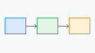
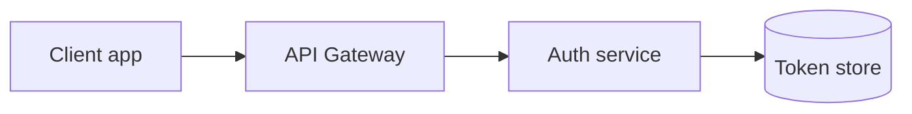

# Token Service Implementation Spec

This spec describes the **token service** that issues and rotates credentials for the
`api-gateway`. See the [OAuth 2.1 draft](https://datatracker.ietf.org/doc/draft-ietf-oauth-v2-1/) for
background &amp; terminology.[^rfc]

## 1 Goals

- Issue short-lived *access tokens* for every client.
- Rotate refresh tokens safely.
  - Detect reuse of a rotated token.
  - Revoke the whole token family on reuse.
- ~~Support SAML assertions~~ (out of scope).

### 1.1 Milestones

1. Prototype the issuer.
2. Ship rotation behind a flag.
3. Remove the legacy session store.

## 2 Architecture





> **Note:** the gateway never stores tokens; it only forwards them
> to the auth service for validation.

## 3 Tokens

| Token | TTL | Storage |
|-------|-----|---------|
| access_token | 15 min | memory |
| refresh_token | 30 d | `token_store` |
| id_token | 15 min | none |

### 3.2 Token refresh

Refresh tokens are rotated on every use, and the previous token is invalidated
immediately. The expected number of refreshes per day is $n = \frac{86400}{t_{ttl}}$.

$$
P(\text{reuse}) = 1 - e^{-\lambda t}
$$

```ts
export async function refresh(token: string): Promise<TokenPair> {
  const family = await store.familyOf(token);
  if (family.revoked) throw new ReuseError(family.id);
  return issuePair(family);
}
```

## 4 Rollout checklist

- [x] Write the design doc
- [ ] Load test the issuer
- [ ] Enable rotation for 10% of clients

<details>
<summary>Open questions</summary>

Should the grace window be **30 s** or configurable per client?

</details>

---

Last revised 2026-10-10.

[^rfc]: OAuth 2.1 consolidates RFC 6749 and its security best current practice.
