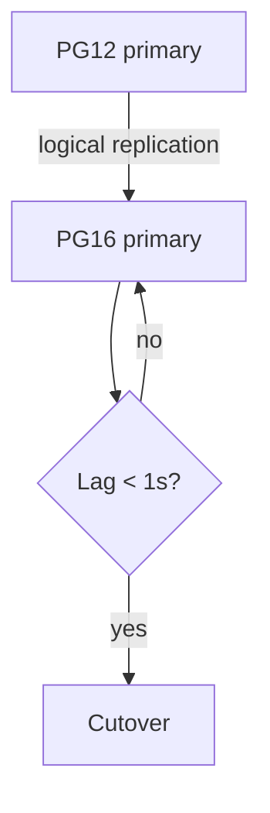

# Postgres 16 Migration Plan

**Status:** Proposed · **Owner:** @data-platform · **Target:** Q1 2027

## Summary

We will upgrade the `orders` cluster from Postgres 12 to Postgres 16 using logical replication. The cutover window is 15 minutes, and the rollback path keeps the old primary warm for 72 hours so that we can fail back without data loss if the new cluster misbehaves under production load during the first three days.

The migration touches the `orders` cluster only. The `orders` cluster serves 41 services.

Setext Heading For Risks
------------------------

Risk is concentrated in three areas: extensions, collation changes, and sequence drift.

## Steps

1. Provision the PG16 cluster with the same parameter group.
2. Create the publication on the source:

   ```sql
   CREATE PUBLICATION orders_pub FOR ALL TABLES;
   -- verify
   SELECT * FROM pg_publication_tables WHERE pubname = 'orders_pub';
   ```

3. Create the subscription on the target, then wait for the initial copy:
   ```sql
   CREATE SUBSCRIPTION orders_sub
     CONNECTION 'host=pg12-primary dbname=orders'
     PUBLICATION orders_pub;
   ```
4. Sync sequences (logical replication does **not** replicate them):
   - run `scripts/sync_sequences.py --dry-run` first
   - then run it for real during the cutover
5. Flip the `DATABASE_URL` secret and restart the
   connection poolers one AZ at a time.

> **Warning**
> Do not drop the old cluster before the 72-hour soak ends.
>
> ```bash
> # check replication lag before cutover
> psql -c "SELECT now() - pg_last_xact_replay_timestamp() AS lag;"
> ```

## The `retry_after` Header

Clients that receive `503` during cutover must honour `Retry-After`. Escape tests: \*not emphasis\*, a literal 1\. at line start, and a backslash path C:\\data\\pg.

| Check | Command | Expected |
|-------|---------|----------|
| Replication lag | `SELECT pg_last_xact_replay_timestamp();` | < 1 s |
| Row counts | `SELECT count(*) FROM orders;`<br>on both sides | equal |
| Extensions | `\dx` | `pg_stat_statements`, `pgcrypto` |

### Compatibility notes

* PG16 removes `pg_stat_statements.track_planning` default changes — re-check dashboards.
* The `public` schema no longer grants `CREATE` to everyone — our migrations role must be granted explicitly.
* Collation: glibc 2.28 changed sort order → **reindex** all text indexes on the target.

Line one with a hard break  
line two after the break.

Our SLO is 99.95% → roughly 21.6 minutes of downtime per 30 days; the cutover alone would consume 70% of that budget.

<table>
  <tr><th>Phase</th><th>Duration</th></tr>
  <tr><td>Initial copy</td><td>~6 h for 1.2 TB</td></tr>
  <tr><td>Catch-up</td><td>&lt; 10 min</td></tr>
</table>

<dl>
  <dt>Soak period</dt>
  <dd>The 72 hours after cutover during which the old primary stays warm.</dd>
</dl>



$$
\text{downtime} \le 15\,\text{min}
$$

[](https://ci.example.com/orders)

Final note: see https://wiki.example.com/pg16 for the runbook. 中文说明：迁移期间禁止写入。 🚀
