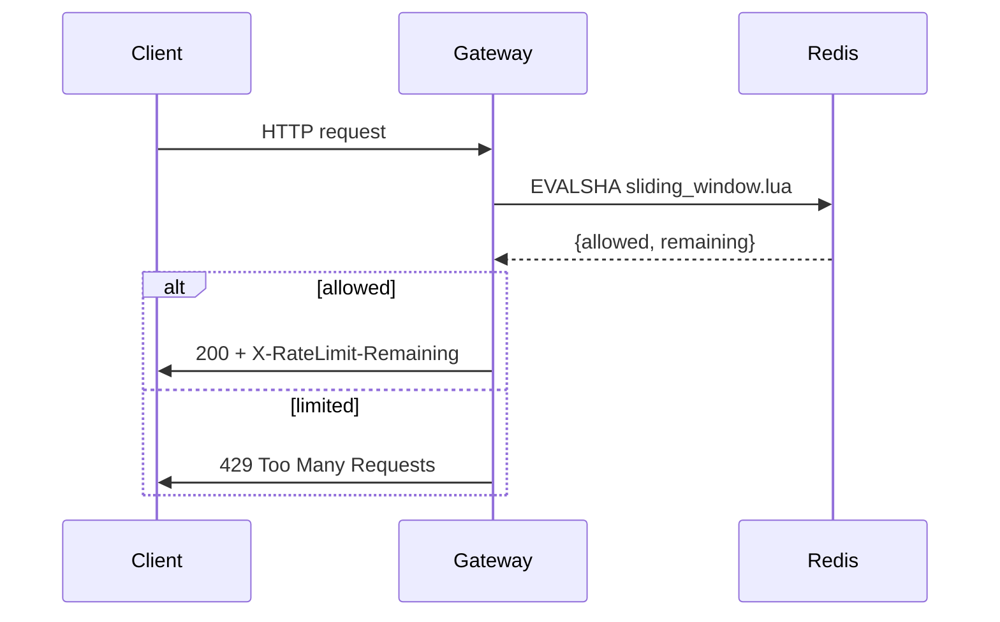

# Distributed Rate Limiter — Design Spec

> **TL;DR** — We replace the per-node token buckets with a *sliding-window log*
> stored in Redis, keyed by `tenant_id:route`. Expected p99 overhead is **< 2 ms**.[^perf]

## 1. Background & Motivation

Today each gateway node enforces limits independently, so a tenant hitting *N* nodes
effectively gets `N × limit` requests per window. This was acceptable when we ran
3 nodes; with autoscaling up to 40 nodes it is not.[^history]

Key problems:

1. **Inconsistent enforcement** across nodes
   - burst traffic gets through on cold nodes
   - limits scale with fleet size, not with the contract
2. **No visibility**: we can't answer "how close is tenant X to their limit?"
3. Config lives in three places (`gateway.yaml`, the admin UI, and a hard-coded
   fallback in `limits.go`)

## 2. Goals and Non-Goals

### 2.1 Goals

- [x] Global (cluster-wide) enforcement per `tenant_id` × `route`
- [x] p99 added latency under 2 ms at 50k RPS
- [ ] Hot-reload of limit config without restarts
- [ ] Per-tenant dashboards

### 2.2 Non-Goals

- ~~Billing integration~~ (tracked separately in [PLAT-1234][jira])
- Geo-distributed consistency — each region enforces on its own

## 3. Algorithm

We use a sliding-window counter. For a window of length $W$ and a request at time $t$,
the effective count is:

$$
\text{count}(t) = c_{\text{curr}} + c_{\text{prev}} \cdot \frac{W - (t \bmod W)}{W}
$$

A request is admitted iff $\text{count}(t) < L$, where $L$ is the tenant's limit. The
amortised cost is $O(1)$ per request and the memory per key is $O(1)$ as well.



### 3.1 Lua script

The check-and-increment must be atomic, so it runs as a Redis script:

```lua
-- KEYS[1] = current window key, KEYS[2] = previous window key
-- ARGV[1] = limit, ARGV[2] = window_ms, ARGV[3] = now_ms
local curr = tonumber(redis.call("GET", KEYS[1]) or "0")
local prev = tonumber(redis.call("GET", KEYS[2]) or "0")
local elapsed = tonumber(ARGV[3]) % tonumber(ARGV[2])
local weight = (tonumber(ARGV[2]) - elapsed) / tonumber(ARGV[2])
local count = curr + prev * weight
if count >= tonumber(ARGV[1]) then
  return {0, 0}
end
redis.call("INCR", KEYS[1])
redis.call("PEXPIRE", KEYS[1], tonumber(ARGV[2]) * 2)
return {1, math.floor(tonumber(ARGV[1]) - count - 1)}
```

## 4. Configuration

Limits are declared per route. The `match` field supports globs; pipes in regexes must be
escaped inside tables.

| Route pattern | Limit | Window | Notes |
|:--------------|------:|:------:|-------|
| `/v1/search*` | 600 | 60 s | burst-heavy; see §5 |
| `/v1/orders/{id}` | 120 | 60 s | per tenant |
| `/v1/(users\|accounts)/*` | 300 | 60 s | regex alternation: `users\|accounts` |
| `*` (default) | 1,000 | 60 s | applies when nothing else matches |

Example config:

```yaml
limits:
  - match: "/v1/search*"
    limit: 600
    window: 60s
  - match: "/v1/orders/{id}"
    limit: 120
    window: 60s
```

## 5. Failure Modes

<details>
<summary><strong>What happens if Redis is unavailable?</strong></summary>

We **fail open**: requests are admitted and a `rate_limiter_degraded` metric is
emitted. Rationale: a limiter outage must never become a full API outage.

</details>

<details>
<summary>What about clock skew between gateway nodes?</summary>

Skew under 100 ms is tolerated because the window keys are derived from Redis
`TIME`, not the node clock.

</details>

| Failure | Detection | Mitigation |
|---------|-----------|------------|
| Redis primary down | sentinel failover event | fail open, page on-call |
| Lua script evicted | `NOSCRIPT` error | re-`SCRIPT LOAD` and retry once |
| Hot key | `redis_cmd_latency_p99 > 5ms` | shard key by `route` hash |

## 6. Rollout Plan

1. Ship behind the `global_rate_limit` flag (default **off**).
2. Shadow mode for one week: compute decisions, log disagreements, don't enforce.
3. Enable for internal tenants, then 10% → 50% → 100%.

Press <kbd>Ctrl</kbd>+<kbd>Shift</kbd>+<kbd>L</kbd> in the admin UI to open the limit inspector.

## 7. Open Questions

- Should the default window be 60 s or 1 s? Short windows punish bursty but
  well-behaved clients; long windows let a client spend its whole budget in
  the first second.
- Do we need *per-API-key* limits in addition to per-tenant? See the
  [API keys RFC][rfc-keys] and the [gateway README](https://example.com/gateway#limits).

[jira]: https://jira.example.com/browse/PLAT-1234
[rfc-keys]: https://example.com/rfcs/0042-api-keys "API keys RFC"

[^perf]: Measured on a c6i.2xlarge with Redis 7.2 on the same AZ; see the benchmark notebook.
[^history]: The per-node design dates from 2019, when the gateway ran on three fixed hosts.
